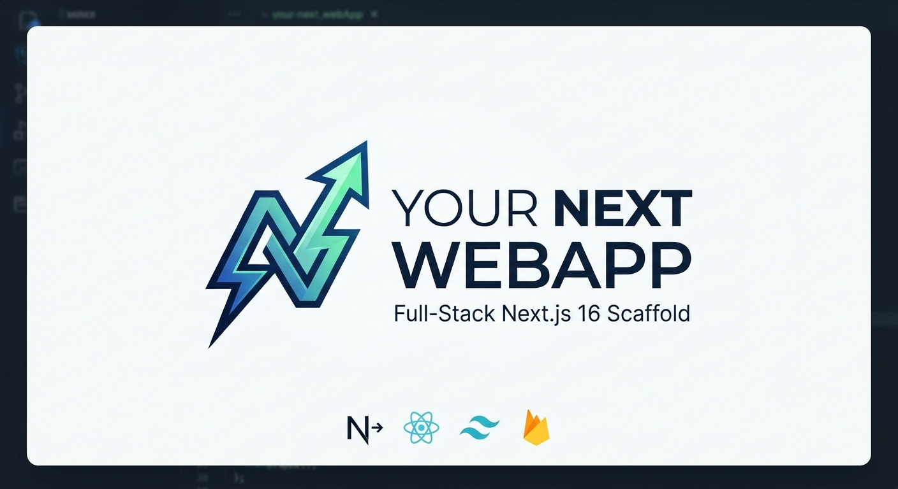

<div align="center">

<a href="https://github.com/exxaio/your-next-webapp">
  
</a>

# ⚡ your-next-webapp

**A production-ready, full-stack Next.js web application template built with Next.js 16, React 19, Tailwind CSS v4, shadcn/ui, next-intl, and Firebase Auth.**

[](./LICENSE)
[](https://nextjs.org/)
[](https://react.dev/)
[](https://tailwindcss.com/)
[](https://www.typescriptlang.org/)
[](https://github.com/exxaio/your-next-webapp/actions/workflows/ci.yml)

[Explore Features](#-features) • [Quick Start](#-quick-start) • [Architecture](#-architecture) • [Documentation](#-documentation) • [Contributing](#-contributing)

</div>

---

## 🌟 Overview

**your-next-webapp** provides a foundation for modern SaaS and AI applications. It combines Next.js 16 (App Router & Turbopack) with a refined design system, full internationalization (English & Simplified Chinese), comprehensive Firebase authentication with OAuth account linking, and operational pages including an interactive node-based workflow builder canvas.

---

## ✨ Features

### 🔐 Authentication & Account Management
- **Full Firebase Auth Suite**: Email/password, Google OAuth, and GitHub OAuth.
- **OAuth Account Linking**: Seamless handling of email collisions when signing in with multiple providers (see [OAuth Linking Guide](docs/OAUTH_ACCOUNT_LINKING.md)).
- **Animated Auth Flows**: 2-step registration with dynamic password strength analysis and password reset.
- **Account Control Center**: Update display name, profile avatar, change or set passwords, link/unlink third-party providers, revoke sessions, and account deletion.

### 🌐 Internationalization (i18n)
- **Built on `next-intl`**: Route-based localization supporting English (`/en`) and Simplified Chinese (`/zh-CN`).
- **Modular Namespace Dictionaries**: Clean separation of translation strings by domain (`Dashboard`, `Billing`, `Workflows`, etc.).
- **Dynamic Language Switcher**: Available in both the sticky top navbar and collapsible sidebar.

### 🎨 Design System & Layout
- **Tailwind CSS v4 & Semantic Tokens**: Dark/light modes powered by `next-themes` with frosted glass (backdrop blur) styling.
- **Dual Layout Archetypes**: Responsive single-column constrained layouts (`max-w-4xl`) for settings and fluid full-width views for dashboards and canvases.
- **Automatic Breadcrumb Resolution**: Breadcrumbs resolved dynamically per route.
- **Accessible UI Primitives**: Built with `@base-ui/react`, shadcn/ui, and Hugeicons.

### 🛠️ Interactive Workflow Builder
- **Node Canvas**: Interactive drag-and-drop workspace with execution engine simulation.
- **Minimap & Navigation**: Live viewport tracker with zoom and panning controls.
- **Node Inspector & Presets**: Configurable node parameters and pre-built starter workflow templates (see [Workflow Builder Docs](docs/WORKFLOW_BUILDER.md)).

### 📊 Operational App Pages
- **`/dashboard`**: Executive dashboard with high-level KPI cards, recent activity, and system alerts.
- **`/analytics`**: Comprehensive telemetry, performance metrics, and charts powered by Recharts.
- **`/models`**: AI model registry with token pricing, context window specs, and latency benchmarks.
- **`/playground`**: Interactive prompt engineering studio with reproducible SDK code export.
- **`/monitoring`**: Real-time edge latency monitoring, error rate tracking, and invocation log stream.
- **`/team`**: Team member directory, invitation modal, and role-based permissions management.
- **`/billing`**: Plan selection, tier feature matrices, quota usage progress bars, and invoice history.

---

<p align="center">
  
</p>

## 🚀 Quick Start

### Prerequisites
- [Node.js](https://nodejs.org/) `20.x` or `22.x` (LTS recommended)
- [pnpm](https://pnpm.io/) `9.x` or later (`npm install -g pnpm`)

### 1. Clone & Install
```bash
git clone https://github.com/exxaio/your-next-webapp.git
cd your-next-webapp
pnpm install
```

### 2. Configure Environment Variables
Copy the example environment configuration template:
```bash
cp .env.example .env.local
```

Open `.env.local` and add your Firebase credentials from the [Firebase Console](https://console.firebase.google.com/):
```env
NEXT_PUBLIC_FIREBASE_API_KEY=your-api-key-here
NEXT_PUBLIC_FIREBASE_AUTH_DOMAIN=your-project-id.firebaseapp.com
NEXT_PUBLIC_FIREBASE_PROJECT_ID=your-project-id
NEXT_PUBLIC_FIREBASE_STORAGE_BUCKET=your-project-id.appspot.com
NEXT_PUBLIC_FIREBASE_MESSAGING_SENDER_ID=your-sender-id
NEXT_PUBLIC_FIREBASE_APP_ID=your-app-id

# Optional:
NEXT_PUBLIC_FIREBASE_MEASUREMENT_ID=G-XXXXXXXXXX
```
> For step-by-step instructions on configuring Firebase Authentication, Google sign-in, and GitHub OAuth, see the [Firebase Setup Guide](docs/FIREBASE_SETUP.md).

### 3. Run Development Server
```bash
pnpm dev
```
Open [http://localhost:3000](http://localhost:3000) to view the application.

---

## 📁 Repository Structure

```
your-next-webapp/
├── .github/                 # GitHub Actions workflows & issue templates
│   ├── workflows/ci.yml     # Automated CI (lint, format, typecheck, build)
│   ├── ISSUE_TEMPLATE/      # Bug report & feature request templates
│   └── pull_request_template.md
├── app/                     # Next.js App Router
│   ├── [locale]/            # Localized route hierarchy (/en, /zh-CN)
│   │   ├── (app)/           # Authenticated application routes
│   │   │   ├── account/     # User profile & account security
│   │   │   ├── analytics/   # System telemetry & charts
│   │   │   ├── billing/     # Plans, usage & billing history
│   │   │   ├── dashboard/   # Executive overview
│   │   │   ├── models/      # Model catalog & specs
│   │   │   ├── monitoring/  # Real-time health & edge logs
│   │   │   ├── playground/  # AI test bench & prompt studio
│   │   │   ├── team/        # Member management & permissions
│   │   │   └── workflows/   # Interactive workflow canvas
│   │   ├── (auth)/          # Authentication pages (login, signup, forgot-pw)
│   │   └── layout.tsx       # Root localized HTML & theme wrapper
│   └── globals.css          # Tailwind CSS v4 design tokens & theme layers
├── components/              # Modular UI components
│   ├── account/             # Account management subsections
│   ├── ui/                  # Accessible Base UI / shadcn design system primitives
│   ├── workflow-builder/    # Canvas, minimap, inspector, and nodes
│   ├── app-sidebar.tsx      # Main collapsible navigation
│   └── top-navbar.tsx       # Sticky frosted navbar with breadcrumbs & language switch
├── docs/                    # In-depth architectural documentation
│   ├── DESIGN_SYSTEM.md     # Design tokens, typography, and contrast rules
│   ├── FIREBASE_SETUP.md    # Firebase Auth & provider configuration guide
│   ├── OAUTH_ACCOUNT_LINKING.md # OAuth conflict resolution flow
│   ├── RESPONSIVE_DESIGN.md # Layout archetypes & responsive guidelines
│   └── WORKFLOW_BUILDER.md  # Canvas architecture & simulation engine
├── hooks/                   # React custom hooks (use-auth, use-mobile)
├── i18n/                    # next-intl configuration & routing definitions
├── lib/                     # Firebase client and utility helpers
├── messages/                # Translation dictionaries
│   ├── en/                  # English locale JSON strings
│   └── zh-CN/               # Simplified Chinese locale JSON strings
├── middleware.ts            # next-intl locale negotiation proxy
└── package.json
```

---

## 📜 Available Scripts

| Script | Purpose |
| :--- | :--- |
| `pnpm dev` | Starts local Next.js development server with Turbopack |
| `pnpm build` | Builds the optimized production bundle |
| `pnpm start` | Runs the compiled production server |
| `pnpm lint` | Runs ESLint 10 with Next.js Core Web Vitals and TypeScript rules |
| `pnpm typecheck` | Validates TypeScript types across the entire project (`tsc --noEmit`) |
| `pnpm format` | Formats TypeScript and JSX files using Prettier |
| `pnpm format:check` | Verifies code formatting without modifying files |
| `pnpm check` | Runs both format verification and lint checks (enforced on pre-commit) |

---

## 📚 Documentation

Detailed architectural and operational documentation is available in the [`docs/`](./docs) directory:

- 🎨 **[Design System Guide](docs/DESIGN_SYSTEM.md)** — Semantic color palette, dark mode tokens, typography scale, and contrast guidelines.
- 🔑 **[Firebase Setup](docs/FIREBASE_SETUP.md)** — Guide for creating a Firebase project, enabling Email/Password, Google, and GitHub OAuth.
- 🔗 **[OAuth Account Linking](docs/OAUTH_ACCOUNT_LINKING.md)** — Technical breakdown of credential conflict detection and automated account linking.
- 📱 **[Responsive Design Architecture](docs/RESPONSIVE_DESIGN.md)** — Principles for dual layout archetypes, fluid cards, and table scrolling.
- ⚡ **[Workflow Builder Engine](docs/WORKFLOW_BUILDER.md)** — State models, canvas simulation, node definitions, and preset patterns.

---

## 🤝 Contributing

Contributions are warmly welcomed! Please read our **[Contributing Guide](CONTRIBUTING.md)** and review our **[Code of Conduct](CODE_OF_CONDUCT.md)** before submitting pull requests.

1. Fork the repo and create your branch: `git checkout -b feature/amazing-feature`
2. Run validation checks: `pnpm check && pnpm typecheck && pnpm build`
3. Commit your changes: `git commit -m 'feat: add amazing feature'`
4. Push to branch: `git push origin feature/amazing-feature`
5. Open a Pull Request

---

## 🔒 Security

For security vulnerability reports, please refer to our **[Security Policy](SECURITY.md)**.

---

## 📄 License

This project is open source and available under the **[MIT License](LICENSE)**.
